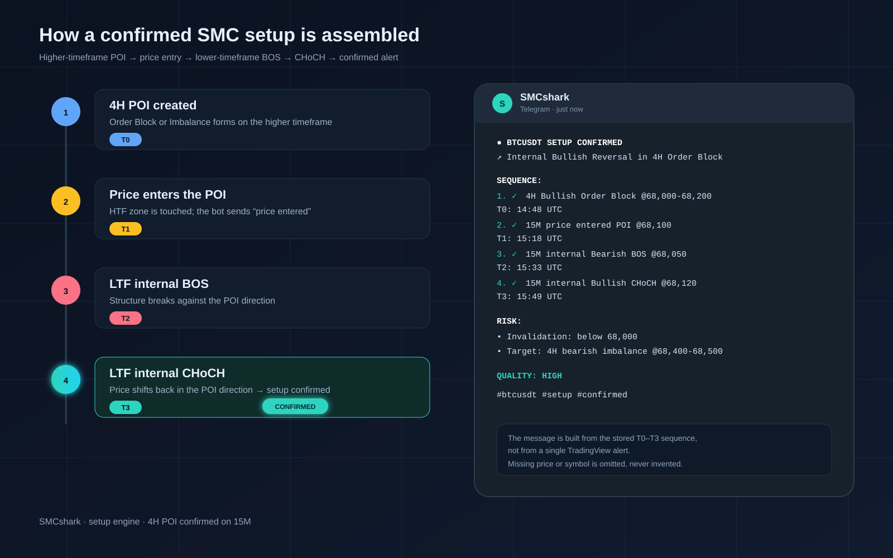
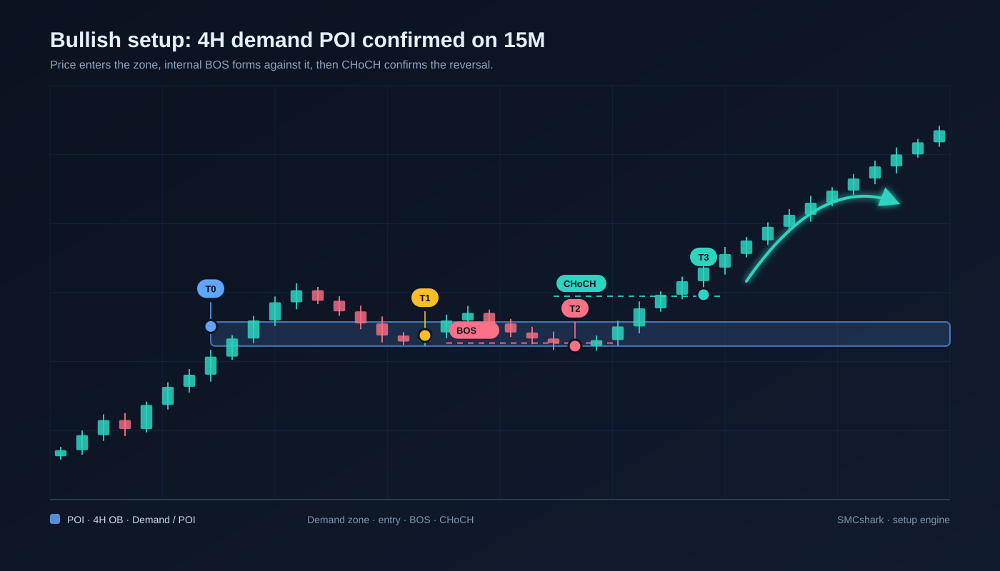
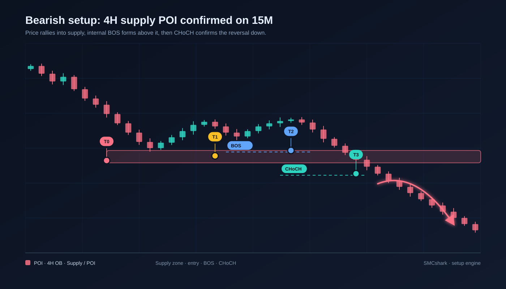
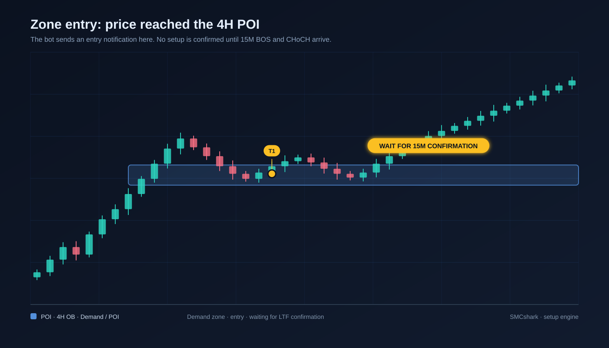
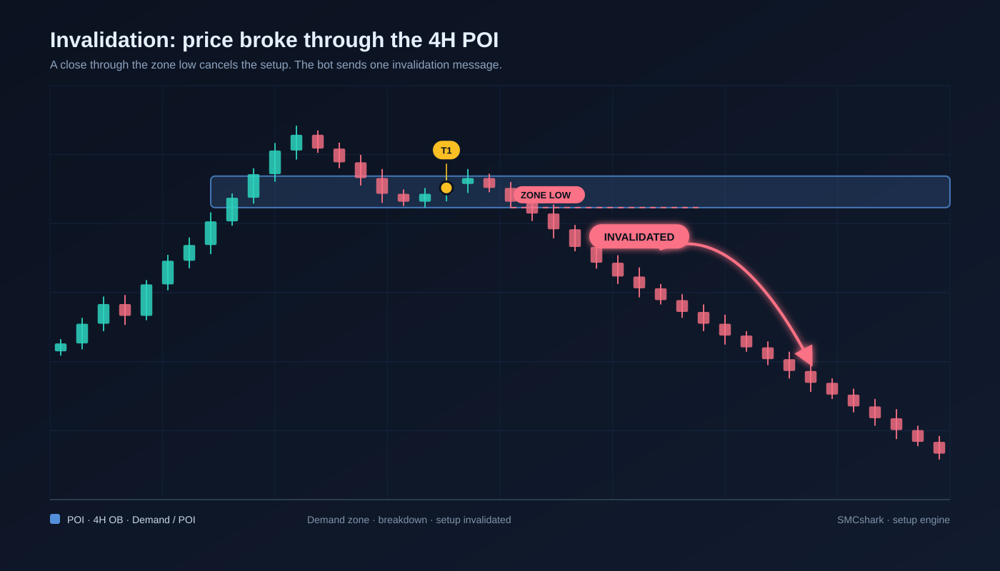

# SMCshark

**TradingView → Telegram bot that turns Smart Money Concepts alerts into HTF → LTF confirmed setups.**

[](https://github.com/jefo/tradingview-setup-alert-bot/actions/workflows/ci.yml)
[](https://bun.sh)
[](https://www.typescriptlang.org/)
[](#testing)
[](LICENSE)

Most alert bots simply forward the text they receive. SMCshark keeps state and only confirms a setup when the full sequence is present:

```
HTF Point of Interest
        ↓
price enters the zone
        ↓
LTF internal BOS against the POI
        ↓
LTF internal CHoCH back in the POI direction
        ↓
SETUP CONFIRMED
```

No confirmation from a POI on another symbol, a stale zone, a CHoCH without BOS, or a zone the price never entered.

---

## Why this project

SMC traders often describe setups as a sequence, not a single alert:

- a higher-timeframe order block or imbalance forms;
- price returns into that zone;
- internal structure breaks against the zone;
- a CHoCH confirms the reversal.

A naïve bot treats every CHoCH as a signal. SMCshark models the sequence as a state machine, scopes it by symbol and timeframe, applies the time windows, and builds the confirmation message from the stored T0–T3 events.

The business rules are documented in [`docs/SetupEngine.md`](docs/SetupEngine.md), and the original analysis is in [`docs/`](docs/).

---

## Features

- **HTF → LTF state machine** — `WAIT_ENTRY → WAIT_BOS → WAIT_CHOCH → CONFIRMED`.
- **Per-symbol state in Redis** — confirmations survive process restarts and do not depend on MongoDB.
- **Strict scoping** — symbol, timeframe, zone age, entry, BOS, CHoCH, invalidation.
- **Time windows** — 24 h POI → entry, 4 h entry → confirmation, 15 min BOS → CHoCH.
- **Real message sequence** — T0–T3 times, prices, zone range, invalidation, target imbalance, quality.
- **No invented data** — missing symbol/price means the field is omitted, not replaced with BTCUSDT.
- **Zone-entry notifications** — “price entered 4H OB, waiting for 15m confirmation”.
- **Invalidation** — scoped by symbol, sent once, including after confirmation.
- **MarkdownV2 safety** — single escaping pass plus plain-text fallback.
- **Webhook protection** — `WEBHOOK_SECRET`, rate limiting, fast `503` when Redis is down.
- **Dry-run and replay** — `DRY_RUN=true` and `bun run replay` require no Telegram or TradingView.

---

## Architecture

```
TradingView alert
      │  POST /alert?secret=...
      ▼
   api.ts ──publish──▶ Redis (raw_signals)
                             │
                             ▼
                    signal-processor.ts
                    ├─ parse type / state / level
                    ├─ extract symbol, timeframe, price, range
                    ├─ SetupEngine (state: smc:setup:<SYMBOL>)
                    │    HTF POI → entry → BOS → CHoCH
                    └─ publish (processed_signals + setup event)
                             │
                             ▼
                         bot.ts
                    ├─ zone entry
                    ├─ confirmed setup (T0–T3)
                    ├─ invalidation
                    └─ pinned market-structure board
```

| Layer | Responsibility |
|---|---|
| `src/api.ts` | webhook, auth, rate limit, Redis publish |
| `src/services/signal-processor.ts` | parse, validate, enrich, run the engine, publish |
| `src/engine/*` | setup state machine, Redis state, message formatting |
| `src/bot.ts` | Telegram delivery, pin board, dry-run |
| `src/market-context.ts` | legacy pinned structure board |

MongoDB is optional: it stores signal history, but setup confirmation works without it.

---

## Setup lifecycle

```
             ┌──────────────────────────────┐
             │  POI_CREATED (HTF OB/Imbalance)
             └───────────────┬──────────────┘
                             ▼
                       WAIT_ENTRY
                             │ price entered the zone
                             ▼
                       WAIT_BOS
                             │ internal BOS against POI
                             ▼
                       WAIT_CHOCH
                             │ internal CHoCH in POI direction
                             ▼
                       CONFIRMED
                             │
                             └──▶ invalidation (exit / opposing structure)
```

Rules enforced by `SetupEngine`:

| Rule | Value |
|---|---|
| POI → entry | ≤ 24 h |
| Entry → confirmation | ≤ 4 h |
| BOS → CHoCH | ≥ 15 min |
| POI timeframe → confirmation timeframe | configured hierarchy |
| Entry price | must be inside the POI range (if price is present) |
| Confirmation | internal BOS against POI, then CHoCH in POI direction |
| Invalidation | zone exit, zone break, or opposing swing structure |
| Confirmation per POI | one; lower TF alternatives are superseded |

Default hierarchy:

| HTF POI | LTF confirmation |
|---|---|
| 1w | 1d, 4h |
| 1d | 4h, 1h |
| 12h | 1h |
| 4h | 15m, 5m |
| 1h | 15m, 5m |
| 15m | 5m, 1m |

---

## Quick start

Requirements: [Bun](https://bun.sh), Redis. MongoDB is optional.

```bash
git clone https://github.com/jefo/tradingview-setup-alert-bot.git
cd tradingview-setup-alert-bot

cp .env.example .env
# set BOT_TOKEN, TELEGRAM_CHANNEL, WEBHOOK_SECRET

docker compose up -d mq mongo
bun install

bun run dev:api   # webhook API
bun run dev:bot   # processor + Telegram bot
```

Health check:

```bash
curl http://localhost:3000/health
```

Send a test alert:

```bash
curl -X POST -H 'Content-Type: text/plain' \
  --data 'Bullish OB Created | BTCUSDT | 4H | 68000-68200' \
  'http://localhost:3000/alert?secret=<WEBHOOK_SECRET>'
```

The bot must be an admin in the target channel with permission to pin messages.

---

## TradingView alert contract

The parser understands the indicator vocabulary (`Bullish OB Created`, `Internal Bearish BOS formed`, `Bullish CHoCH formed`, `Price broke bullish internal OB`, `Bullish FVG formed`, `Equal highs detected`, etc.).

Use a message template that carries market metadata:

```
{{ticker}} | {{interval}} | {{close}} | <condition text>
```

Example:

```
BTCUSDT | 4H | 68228.9 | Bullish OB Created
```

`{{ticker}}` and `{{interval}}` are **required** for the setup engine: without them the bot cannot map an HTF POI to an LTF confirmation. If price is absent, the bot does not invent one — it simply omits price fields.

### Important: the current `smc.pine`

The indicator used with this bot emits BOS/CHoCH, FVG, equal highs/lows, and **OB breakout** (which is invalidation, not entry). It does **not** emit:

- `OB/Imbalance Created`
- `OB/Imbalance Entered`

Without those two events the engine has no T0/T1 and cannot confirm live setups. Add them to the indicator or send equivalent messages from another script. The contract is documented in [`docs/SetupEngine.md`](docs/SetupEngine.md).

---

## Messages

### Zone entry

```
👀 BTCUSDT — price entered 4H Bullish Order Block
Zone: 68,000-68,200
Waiting for 15M / 5M confirmation: internal BOS → CHoCH

#btcusdt #poi #waiting
```

### Confirmed setup

```
🎯 BTCUSDT SETUP CONFIRMED
📈 Internal Bullish Reversal in 4H Order Block

SEQUENCE:
1. ✅ 4H Bullish Order Block @68,000-68,200
   T0: 14:48 UTC
2. ✅ 15M price entered POI @68,100
   T1: 15:18 UTC
3. ✅ 15M internal Bearish BOS @68,050
   T2: 15:33 UTC
4. ✅ 15M internal Bullish CHoCH @68,120
   T3: 15:49 UTC

RISK:
• Invalidation: below 68,000
• Target: 4H bearish imbalance @68,400-68,500

QUALITY: HIGH
#btcusdt #setup #confirmed
```

### Invalidation

```
❌ BTCUSDT SETUP INVALIDATED
4H Bullish Order Block @68,000-68,200
Reason: price exited the zone
LTFs affected: 15M
Time: 16:03 UTC

#btcusdt #invalidation
```

---

## Visual examples

The diagrams are generated by [`scripts/generate-visuals.ts`](scripts/generate-visuals.ts) and committed as SVG, so they stay sharp and versioned.

### How a confirmed setup is assembled



### Bullish and bearish confirmation

| Bullish — 4H demand POI | Bearish — 4H supply POI |
|---|---|
|  |  |

### Zone entry and invalidation

| Price entered the POI | Price broke the POI |
|---|---|
|  |  |

---

## Configuration

| Variable | Required | Description |
|---|---|---|
| `BOT_TOKEN` | yes | Telegram bot token |
| `TELEGRAM_CHANNEL` | yes | channel/chat; the bot must be an admin with pin rights |
| `WEBHOOK_SECRET` | production | `?secret=` or `x-webhook-secret` header |
| `REDIS_URL` | yes | defaults to `redis://127.0.0.1:6390` |
| `PORT` | no | API port, default `3000` |
| `DRY_RUN` | no | `true` logs signals instead of sending them |
| `MONGODB_URL` | no | optional persistence |
| `MONGODB_DB` | no | default `smcshark` |
| `SETUP_POI_TO_ENTRY_SECONDS` | no | default `86400` (24 h) |
| `SETUP_ENTRY_TO_CONFIRM_SECONDS` | no | default `14400` (4 h) |
| `SETUP_BOS_TO_CHOCH_SECONDS` | no | default `900` (15 min) |

`docker-compose.yml` uses `MONGO_USER`, `MONGO_PASSWORD`, `MONGO_EXPRESS_USER`, `MONGO_EXPRESS_PASSWORD` for local development. Do not use the defaults in production.

---

## Testing

```bash
bun run typecheck   # tsc --noEmit
bun test            # 72 tests
bun run replay      # synthetic HTF → LTF sequence, no Telegram
```

The conformance suite in [`src/engine/setup-engine.test.ts`](src/engine/setup-engine.test.ts) covers:

| Case | Expected |
|---|---|
| A | 4H POI + 15m entry/BOS/CHoCH → confirmed |
| B | POI on BTC + CHoCH on ETH → no signal |
| C | 3-day-old POI → no signal |
| D | CHoCH without entry/BOS → no signal |
| E | 1m POI confirmed on 1D → no signal |
| F | invalidated POI → no signal |
| G | standalone swing BOS → not a setup |
| H | Mongo down → confirmation still works |
| I | ETH BOS does not invalidate a BTC setup |

`bun run replay` prints the same messages the bot would send:

```
=== BTCUSDT CHOCH FORMED: CONFIRMED ===

🎯 BTCUSDT SETUP CONFIRMED
📈 Internal Bullish Reversal in 4H Order Block
...
QUALITY: HIGH
```

---

## Project layout

```
src/
  api.ts                  webhook API
  app.ts                  processor + bot entrypoint
  bot.ts                  Telegram delivery and pin board
  signals.ts              parsing and normalization
  engine/
    setup-engine.ts       SMC state machine
    config.ts             timeframe hierarchy and windows
    state-store.ts        Redis + in-memory state
    format.ts             message formatting
    types.ts
  services/
    signal-processor.ts
    signal-validator.ts
    signal-enricher.ts
    signal-repository.ts
    event-publisher.ts
  market-context.ts       legacy pinned board
scripts/replay.ts         local replay
docs/SetupEngine.md       business rules
```

---

## Demo checklist

Before inviting traders:

1. Create a **private** test channel and set `TELEGRAM_CHANNEL`.
2. Make the bot an admin with pin rights.
3. Run with `DRY_RUN=true` for a session and inspect the log.
4. Confirm the TradingView alert template includes `{{ticker}}`, `{{interval}}`, `{{close}}`.
5. Test the full sequence with `bun run replay` and, if needed, `SETUP_BOS_TO_CHOCH_SECONDS=0`.
6. Check that a signal from another symbol does not produce a message.
7. Add the disclaimer to the channel description.

---

## Limitations and roadmap

- The current `smc.pine` lacks `OB Created` / `OB Entered` alerts — the main blocker for live confirmations.
- One Telegram channel and one pinned board; per-user subscriptions are not implemented.
- T0–T3 use alert receipt time; parsing `{{time}}` for bar time is on the roadmap.
- No historical backtest importer yet; replay is synthetic.
- The pinned board still uses the legacy global market context and should be moved to engine state for multi-symbol demos.

---

## Security

- `.env` is ignored and must never be committed.
- The webhook is protected by `WEBHOOK_SECRET`; keep it in the URL or header, not in logs.
- If you reuse an old repository, rotate any credentials that were previously committed.
- The bot only needs permission to post and pin in one channel.

---

## Disclaimer

This project is a technical case study. It is **not financial advice** and does not guarantee trading results. Use it at your own risk.

## License

GPL-3.0. See [`LICENSE`](LICENSE).
